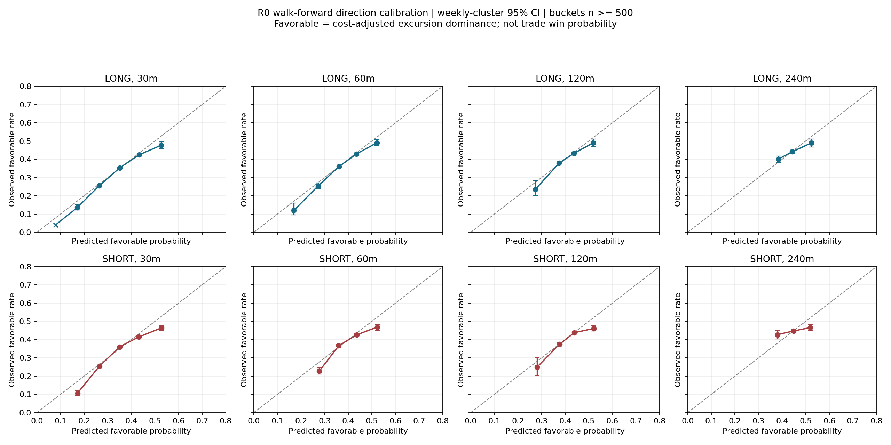
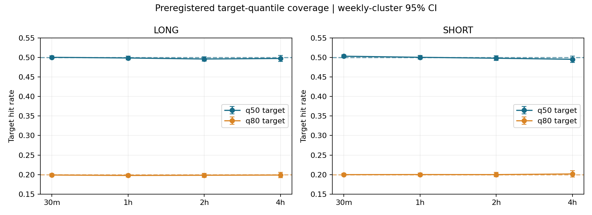
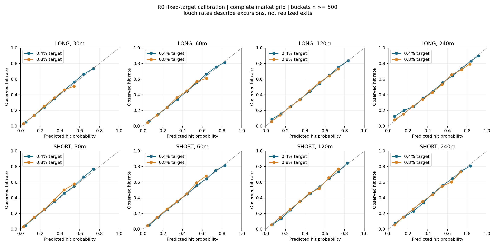

# Directional Probability Model R0 — 결과

**판정: B. WEAK_DIRECTIONAL_MODEL.** 30m/1h에서 비용 보정 path 우위와 target 분포에 통계적 정보가 있으나, 순수 방향 구분과 비용 후 실행 가능한 threshold의 근거는 부족하다. C 판정 horizon은 없다. 이번 결과는 고정한 R0 모델군의 검증이며 모든 방향 모델의 가능성을 부정하는 결론은 아니다.

새로운 운영 신호, PAPER/LIVE/UI 또는 production 구현은 없다. C1/C1x 미변경. commit/push 미수행. 2026-10-03 KST 작성. 이 보고서는 과거 검증이며 현재 BTC 가격의 실시간 예측을 제공하지 않는다.

## 데이터·decision grid

기존 Bybit BTCUSDT OHLC/mark/index/OI/funding, Binance USD-M·spot 참조를 사용했다. 원본 2021-02-01~2026-09-22, 연구 표본 2021-03-04부터, OOS 2022-01-01~2026-09-22. **5분 decision grid**: OI의 5분 갱신 및 +5분 공개 지연 계약에 맞추었다. 미래 경로는 1분 high/low로 계산한다. C1에 관계없이 모든 적격 시장 시점을 학습·평가했다.

전체 적격 5분 표본 582,389개, 각 horizon의 OOS 496,354개. 외부 참조가 5분 넘게 낡았던 최근 24h 구간에서 후보 1,915개를 제외했다. 최대 4h 미래 경로를 완전히 관측할 수 있는 공통 표본을 썼다. 평가 fold 끝 4h도 제거했다. 이 496,354개는 독립 거래 수가 아니다.

PIT: 직전 마감봉, OI timestamp+5m, funding은 이미 정산된 값, Binance는 마감 후 관측된 close만 사용. OI/funding 원본 재결합 불일치 0, OHLC 오류 0, feature truncation 3개 시점 모두 통과. 원본 publication latency·vendor revision의 완전한 재현은 아님. 440ms feed 지연과 실제 historical book은 재현하지 못한다.

## Feature·모델·target 사전 고정

20개 feature: 5/30/60/240m return÷RV24h, 4h range 위치, log RV1h/log RV24h와 비율, OI 1h/4h/24h log 변화, settled funding, mark/index basis와 1h 변화, Binance perp/spot premium과 1h 변화, Bybit−Binance·spot−perp 1h 상대 return÷RV24h, UTC 시각 sin/cos. C1은 feature에 넣지 않았다.

U=다음 시가 대비 미래 최대 상승폭(bp), D=최대 하락폭의 양수 크기(bp). **LONG favorable = U−D > LONG 실제 MARKET 비용**, SHORT는 D−U > SHORT 비용. 음의 funding으로 총비용이 음수가 되면 비교 비용은 0으로 floor. 이는 비용을 넘는 excursion dominance이며 endpoint 상승확률이나 실제 거래 승률이 아니다. 두 label은 서로 배타적이며 둘 다 false일 수 있다. LONG MFE=U/MAE 크기=D, SHORT는 그 반대다.

단일 고정 ridge logistic(L2=10), fit-only median/MAD scaling. 별도 시간순 calibration 90일에서 logit에 logistic calibration(L2=1)을 학습했다. 확률을 임의 점수에서 변환하지 않았다. 상수 baseline은 같은 calibration 구간의 발생률. Hyperparameter/model/feature sweep 없음.

Target: 같은 feature로 log1p(U), log1p(D) ridge 회귀(L2=10), fit에서 정한 RV24h 3분위별 calibration residual 경험분포로 CDF를 보정했다. **q50/q80**을 고정했으므로 target 도달확률의 사전 주장은 **50%/20%**다. 고정 **±0.4%, ±0.8%** 도달확률도 별도 평가. 결과를 보고 percentile을 선택하지 않았다. 이것은 U/D 주변분포이며 완전한 시간순 path joint distribution은 아니다.

가격 출력은 decision close×(1±target bp/10000), 실제 경로 평가는 next-open 기준. 각 표본의 target 가격·%·hit probability는 prediction parquet에 보존했다. 아래 target %는 전체 상태의 평균으로, 현재 가격에 적용할 고정 TP가 아니다.

## Walk-forward·중복 표본

2022-01부터 반기별 9개 expanding fold, 마지막 fold는 2026-09-23 직전 종료. test 직전 90일은 calibration, 그 이전은 fit. fit/cal 및 cal/test 경계에 240분 purge. 학습·보정·평가가 시간순으로 분리되며 test label이 다음 fold로 넘어가지 않는다.

주 단위 cluster를 fold별로 재표집한 bootstrap 2,000회. 일반 CI는 95%, 방향 Brier 개선·경제 진단에는 4 horizon을 고려한 98.75% CI도 계산. UTC 4h 정시 한 phase의 비중복 샘플을 별도 검증. cluster<20 또는 유효 재표집 자유도<10이면 CI는 N/A. 일주일 이상 regime 의존성은 남는다. 이 아카이브는 과거 연구에서 반복 사용되었으므로 **model-level OOS, untouched holdout 아님**.

## LONG/SHORT calibration

| 분 | 방향 | Brier | BSS | AUC | ECE | 평균 예측 | 실제 favorable | Brier 개선 98.75% CI |
|---|---|---|---|---|---|---|---|---|
| 30 | LONG | 0.219411 | 2.29% | 0.591 | 0.65% | 34.51% | 34.10% | [0.004348, 0.005983] |
| 30 | SHORT | 0.220988 | 2.19% | 0.586 | 1.37% | 34.85% | 34.47% | [0.004176, 0.005787] |
| 60 | LONG | 0.233483 | 1.27% | 0.565 | 0.45% | 38.85% | 38.40% | [0.002347, 0.003703] |
| 60 | SHORT | 0.235183 | 1.09% | 0.558 | 1.08% | 39.29% | 38.89% | [0.002008, 0.003223] |
| 120 | LONG | 0.241861 | 0.55% | 0.541 | 0.55% | 42.02% | 41.73% | [0.000817, 0.001884] |
| 120 | SHORT | 0.243223 | 0.35% | 0.537 | 0.45% | 42.68% | 42.23% | [0.000341, 0.001369] |
| 240 | LONG | 0.246231 | 0.11% | 0.522 | 0.55% | 44.20% | 44.00% | [-0.000257, 0.000810] |
| 240 | SHORT | 0.247662 | -0.04% | 0.517 | 1.14% | 45.05% | 44.76% | [-0.000714, 0.000512] |

BSS는 상수 발생률 baseline 대비 개선율. 30m/1h는 양방향 모두 9/9 fold, 5/5 year BSS 양수. 2h는 LONG 9/9, SHORT 7/9 fold 양수지만 개선폭 1% 미만. 4h SHORT는 4/9 fold·2/5 year만 양수. 30m/1h가 방향 및 target calibration 비교에서 가장 안정적이며, 30m이 상대적으로 우세했다. 이는 horizon의 진단 비교이지 전략 청산시간 선택이 아니다.

전체 표본 bucket의 Spearman은 양방향·전 horizon에서 1.0이지만, 500개 이상 bucket만 포함한 기술통계다. 높은 확률 꼬리는 소표본이므로 이 단조성을 실전 threshold 근거로 확대하지 않는다.

## 방향 정보와 변동폭 정보를 구분한 진단

| 분 | favorable 내 방향 AUC | P_LONG/P_SHORT 상관 | 방향 score/실제 U−D 순위상관 | 큰 확률 방향 net bp | 확률합>1 비율 |
|---|---|---|---|---|---|
| 30 | 0.521 | 0.762 | 0.026 | -10.502 | 0.99% |
| 60 | 0.515 | 0.566 | 0.023 | -10.378 | 0.96% |
| 120 | 0.512 | 0.156 | 0.019 | -10.150 | 0.79% |
| 240 | 0.507 | -0.368 | 0.013 | -11.121 | 0.70% |

추가 진단은 기존 예측을 읽기만 했으며 재학습하지 않았다. 어느 한 방향에 비용을 넘는 우위가 실제 있었던 표본에서 P_LONG−P_SHORT의 LONG/SHORT ranking AUC를 평가했다. 이 차이를 새 확률로 표시하지 않았다. 30m AUC 0.521, 4h 0.507은 방향 선택 정보가 매우 약함을 보여준다. 두 favorable 확률의 양의 상관과 거의 대칭인 MFE/MAE는 전체 Brier 개선의 일부가 비용 대비 움직임 크기/중립 상태 구분에 의존한다는 해석과 일치한다. Feature ablation을 수행하지 않았으므로 이를 인과적으로 분해했다고 주장하지 않는다.

**결합확률 일관성 실패:** 배타적인 두 label에 별도 binary 모델을 사용해 약 0.7~1.0% 행에서 합이 1을 넘었다. 최대 합은 horizon에 따라 1.297, 1.223, 1.143, 1.156. 임의 정규화로 숨기지 않았다. 이 결과를 “LONG 63% / SHORT 37%” 같은 완성된 joint probability로 제공할 수 없다.

## Probability bucket별 실제 성과

각 표의 실제 favorable은 label 발생률이며 win은 endpoint MARKET 비용 후 양수 비율이다. net/PF는 겹치는 가상 관측의 진단 통계이며 포트폴리오 손익이 아니다. N/A CI는 cluster 부족, N/A PF는 관측 손실 부재를 뜻한다.

### 30분

| 방향 | bucket | N | 예측 | 실제 favorable | 실제 % 95% CI | net bp | net 95% CI | PF | win | MFE/MAE bp |
|---|---|---|---|---|---|---|---|---|---|---|
| LONG | 0.0-0.1 | 611 | 7.92% | 4.09% | [N/A, N/A] | -11.208 | [N/A, N/A] | 0.024 | 2.78% | 3.104/3.369 |
| LONG | 0.1-0.2 | 12,085 | 17.09% | 13.51% | [12.22, 15.15] | -10.816 | [-11.101, -10.475] | 0.077 | 9.23% | 6.853/6.606 |
| LONG | 0.2-0.3 | 115,566 | 26.42% | 25.53% | [24.95, 26.13] | -10.969 | [-11.218, -10.714] | 0.193 | 20.10% | 13.067/12.986 |
| LONG | 0.3-0.4 | 257,999 | 35.04% | 35.26% | [34.88, 35.63] | -11.196 | [-11.476, -10.920] | 0.367 | 31.35% | 22.923/23.644 |
| LONG | 0.4-0.5 | 103,679 | 43.29% | 42.45% | [41.85, 43.01] | -10.624 | [-11.439, -9.872] | 0.580 | 40.26% | 41.385/41.708 |
| LONG | 0.5-0.6 | 6,282 | 52.57% | 47.66% | [45.96, 49.59] | -5.629 | [-9.355, -1.519] | 0.847 | 47.71% | 74.464/73.495 |
| LONG | 0.6-0.7 | 130 | 62.00% | 65.38% | [N/A, N/A] | 45.059 | [N/A, N/A] | 2.594 | 63.08% | 141.814/83.142 |
| LONG | 0.7-0.8 | 2 | 75.11% | 100.00% | [N/A, N/A] | 520.890 | [N/A, N/A] | N/A | 100.00% | 646.515/64.787 |
| SHORT | 0.0-0.1 | 309 | 8.17% | 7.44% | [N/A, N/A] | -11.112 | [N/A, N/A] | 0.007 | 3.88% | 2.834/3.195 |
| SHORT | 0.1-0.2 | 9,590 | 17.20% | 10.67% | [9.52, 12.07] | -11.759 | [-12.154, -11.394] | 0.039 | 5.97% | 5.805/6.478 |
| SHORT | 0.2-0.3 | 115,861 | 26.48% | 25.42% | [24.75, 26.09] | -11.466 | [-11.726, -11.208] | 0.170 | 19.44% | 12.695/13.019 |
| SHORT | 0.3-0.4 | 249,277 | 35.06% | 36.04% | [35.60, 36.48] | -11.064 | [-11.365, -10.767] | 0.374 | 31.06% | 23.399/22.985 |
| SHORT | 0.4-0.5 | 113,195 | 43.23% | 41.51% | [40.94, 42.11] | -10.908 | [-11.542, -10.274] | 0.561 | 38.11% | 40.319/39.560 |
| SHORT | 0.5-0.6 | 7,800 | 52.81% | 46.44% | [45.06, 47.83] | -10.724 | [-13.818, -8.056] | 0.693 | 42.78% | 66.673/60.641 |
| SHORT | 0.6-0.7 | 317 | 62.44% | 46.37% | [37.58, 52.80] | -32.128 | [-61.035, -5.434] | 0.516 | 38.17% | 108.904/108.141 |
| SHORT | 0.7-0.8 | 3 | 73.37% | 100.00% | [N/A, N/A] | 111.950 | [N/A, N/A] | 7.307 | 66.67% | 237.271/63.767 |
| SHORT | 0.8-0.9 | 2 | 81.86% | 0.00% | [N/A, N/A] | -182.286 | [N/A, N/A] | 0.000 | 0.00% | 13.546/241.088 |

### 60분

| 방향 | bucket | N | 예측 | 실제 favorable | 실제 % 95% CI | net bp | net 95% CI | PF | win | MFE/MAE bp |
|---|---|---|---|---|---|---|---|---|---|---|
| LONG | 0.0-0.1 | 38 | 8.86% | 0.00% | [N/A, N/A] | -14.436 | [N/A, N/A] | 0.000 | 0.00% | 1.545/6.187 |
| LONG | 0.1-0.2 | 1,477 | 16.97% | 11.98% | [9.48, 16.01] | -11.116 | [-11.759, -10.417] | 0.055 | 7.58% | 6.495/6.495 |
| LONG | 0.2-0.3 | 28,960 | 27.24% | 25.43% | [23.99, 27.03] | -10.379 | [-11.008, -9.763] | 0.227 | 19.77% | 13.964/13.473 |
| LONG | 0.3-0.4 | 253,877 | 36.04% | 35.96% | [35.41, 36.49] | -11.267 | [-11.750, -10.777] | 0.408 | 32.02% | 26.223/27.179 |
| LONG | 0.4-0.5 | 201,549 | 43.52% | 42.97% | [42.41, 43.51] | -10.786 | [-11.681, -9.899] | 0.615 | 40.90% | 47.671/48.708 |
| LONG | 0.5-0.6 | 10,345 | 52.13% | 49.04% | [47.62, 50.71] | -2.701 | [-6.229, 1.711] | 0.939 | 47.87% | 98.119/90.354 |
| LONG | 0.6-0.7 | 107 | 61.97% | 66.36% | [46.15, 83.55] | 41.656 | [-47.752, 108.829] | 1.812 | 66.36% | 164.280/112.995 |
| LONG | 0.7-0.8 | 1 | 77.10% | 100.00% | [N/A, N/A] | 848.945 | [N/A, N/A] | N/A | 100.00% | 938.713/5.404 |
| SHORT | 0.1-0.2 | 409 | 18.06% | 13.94% | [8.93, 17.67] | -11.300 | [-13.101, -10.107] | 0.057 | 8.07% | 5.991/6.181 |
| SHORT | 0.2-0.3 | 19,484 | 27.72% | 22.76% | [21.10, 24.49] | -11.809 | [-12.509, -11.128] | 0.147 | 16.40% | 11.970/12.897 |
| SHORT | 0.3-0.4 | 252,890 | 35.99% | 36.66% | [36.09, 37.24] | -11.428 | [-11.933, -10.915] | 0.407 | 31.79% | 26.755/26.861 |
| SHORT | 0.4-0.5 | 212,330 | 43.62% | 42.66% | [42.04, 43.29] | -10.997 | [-11.823, -10.142] | 0.605 | 38.76% | 47.754/46.436 |
| SHORT | 0.5-0.6 | 11,064 | 52.24% | 46.83% | [45.16, 48.23] | -10.516 | [-13.840, -7.372] | 0.735 | 41.96% | 81.531/71.116 |
| SHORT | 0.6-0.7 | 165 | 62.48% | 42.42% | [32.35, 51.28] | -26.143 | [-89.018, 18.402] | 0.623 | 39.39% | 122.200/114.753 |
| SHORT | 0.7-0.8 | 12 | 72.44% | 33.33% | [N/A, N/A] | -31.529 | [N/A, N/A] | 0.007 | 16.67% | 32.853/67.942 |

### 120분

| 방향 | bucket | N | 예측 | 실제 favorable | 실제 % 95% CI | net bp | net 95% CI | PF | win | MFE/MAE bp |
|---|---|---|---|---|---|---|---|---|---|---|
| LONG | 0.1-0.2 | 180 | 17.73% | 10.00% | [N/A, N/A] | -12.189 | [N/A, N/A] | 0.050 | 9.44% | 6.468/8.639 |
| LONG | 0.2-0.3 | 3,341 | 27.28% | 23.44% | [20.09, 28.27] | -10.931 | [-12.267, -9.614] | 0.196 | 18.11% | 13.905/14.549 |
| LONG | 0.3-0.4 | 147,308 | 37.43% | 37.89% | [36.87, 38.88] | -11.057 | [-12.142, -10.035] | 0.488 | 33.83% | 33.399/34.422 |
| LONG | 0.4-0.5 | 330,161 | 43.76% | 43.32% | [42.74, 43.89] | -10.811 | [-12.013, -9.629] | 0.663 | 41.52% | 56.919/58.734 |
| LONG | 0.5-0.6 | 15,286 | 51.82% | 48.93% | [46.84, 51.17] | -2.812 | [-9.346, 4.220] | 0.944 | 47.67% | 112.801/104.715 |
| LONG | 0.6-0.7 | 77 | 62.65% | 62.34% | [N/A, N/A] | 0.991 | [N/A, N/A] | 1.011 | 59.74% | 161.826/145.567 |
| LONG | 0.7-0.8 | 1 | 73.96% | 100.00% | [N/A, N/A] | 984.999 | [N/A, N/A] | N/A | 100.00% | 1137.585/5.404 |
| SHORT | 0.1-0.2 | 4 | 18.92% | 0.00% | [N/A, N/A] | -10.327 | [N/A, N/A] | 0.022 | 25.00% | 7.521/4.689 |
| SHORT | 0.2-0.3 | 1,246 | 28.04% | 24.88% | [20.43, 30.09] | -12.458 | [-16.916, -8.936] | 0.191 | 18.22% | 13.247/15.285 |
| SHORT | 0.3-0.4 | 129,725 | 37.63% | 37.49% | [36.46, 38.52] | -12.205 | [-13.432, -11.046] | 0.453 | 33.19% | 32.239/33.609 |
| SHORT | 0.4-0.5 | 336,135 | 43.85% | 43.79% | [43.16, 44.43] | -11.323 | [-12.507, -10.140] | 0.649 | 39.64% | 58.181/56.579 |
| SHORT | 0.5-0.6 | 29,009 | 52.09% | 46.11% | [44.64, 47.56] | -9.093 | [-11.825, -5.929] | 0.763 | 41.67% | 80.624/71.374 |
| SHORT | 0.6-0.7 | 228 | 62.52% | 40.79% | [28.16, 54.55] | -33.162 | [-109.163, 28.864] | 0.607 | 31.14% | 131.723/129.706 |
| SHORT | 0.7-0.8 | 7 | 73.36% | 28.57% | [N/A, N/A] | -44.968 | [N/A, N/A] | 0.141 | 28.57% | 36.949/120.229 |

### 240분

| 방향 | bucket | N | 예측 | 실제 favorable | 실제 % 95% CI | net bp | net 95% CI | PF | win | MFE/MAE bp |
|---|---|---|---|---|---|---|---|---|---|---|
| LONG | 0.2-0.3 | 127 | 28.42% | 17.32% | [N/A, N/A] | -15.312 | [N/A, N/A] | 0.067 | 7.09% | 12.001/14.263 |
| LONG | 0.3-0.4 | 51,676 | 38.44% | 40.10% | [38.39, 41.81] | -12.370 | [-15.114, -9.787] | 0.552 | 35.94% | 46.753/49.944 |
| LONG | 0.4-0.5 | 414,012 | 44.32% | 44.14% | [43.35, 44.89] | -10.237 | [-12.283, -8.240] | 0.740 | 42.66% | 73.858/76.062 |
| LONG | 0.5-0.6 | 30,152 | 52.34% | 48.92% | [46.67, 51.07] | -6.264 | [-15.445, 2.979] | 0.891 | 47.87% | 124.398/119.901 |
| LONG | 0.6-0.7 | 382 | 62.31% | 46.34% | [29.75, 69.89] | -42.229 | [-98.356, 52.250] | 0.632 | 45.55% | 156.764/202.390 |
| LONG | 0.7-0.8 | 5 | 71.69% | 60.00% | [N/A, N/A] | 86.770 | [N/A, N/A] | 1.453 | 60.00% | 349.756/297.561 |
| SHORT | 0.2-0.3 | 74 | 28.76% | 27.03% | [N/A, N/A] | -17.629 | [N/A, N/A] | 0.646 | 24.32% | 59.776/70.637 |
| SHORT | 0.3-0.4 | 44,522 | 38.00% | 42.72% | [40.34, 45.10] | -13.333 | [-17.375, -9.221] | 0.595 | 38.97% | 53.786/55.586 |
| SHORT | 0.4-0.5 | 392,992 | 44.82% | 44.72% | [43.92, 45.52] | -11.785 | [-13.881, -9.695] | 0.707 | 41.20% | 75.646/74.116 |
| SHORT | 0.5-0.6 | 58,567 | 51.97% | 46.59% | [44.86, 48.31] | -10.977 | [-15.042, -6.234] | 0.760 | 42.75% | 95.605/88.187 |
| SHORT | 0.6-0.7 | 198 | 62.17% | 45.45% | [32.30, 64.33] | -11.808 | [-85.176, 80.184] | 0.879 | 40.40% | 203.705/182.489 |
| SHORT | 0.7-0.8 | 1 | 77.66% | 100.00% | [N/A, N/A] | -39.358 | [N/A, N/A] | 0.000 | 0.00% | 193.493/132.730 |

특히 30m LONG 50~60% bucket: 실제 favorable 47.66%, net −5.63bp. SHORT 50~60%: 실제 46.44%, net −10.72bp. LONG 60% 이상 일부 관측은 양수이나 겹치는 소수 행이고 주별 cluster가 부족해 threshold의 증거로 인정하지 않았다.

## Target price calibration

| 분 | 방향 | 평균 TP1 q50 | 실제 hit (주장50%) | 95% CI | 평균 TP2 q80 | 실제 hit (주장20%) | 95% CI | pinball 개선 q50/q80 | 비용 이하 q50/q80 |
|---|---|---|---|---|---|---|---|---|---|
| 30 | LONG | +0.180% | 50.01% | [0.496, 0.504] | +0.372% | 19.90% | [0.195, 0.203] | 10.10%/16.73% | 38.37%/5.06% |
| 30 | SHORT | −0.181% | 50.29% | [0.500, 0.506] | −0.377% | 20.00% | [0.197, 0.203] | 9.76%/17.17% | 37.80%/4.39% |
| 60 | LONG | +0.260% | 49.84% | [0.494, 0.503] | +0.535% | 19.79% | [0.194, 0.202] | 9.48%/15.31% | 14.53%/1.33% |
| 60 | SHORT | −0.261% | 50.01% | [0.496, 0.505] | −0.541% | 20.02% | [0.196, 0.205] | 9.19%/15.80% | 14.07%/1.09% |
| 120 | LONG | +0.375% | 49.58% | [0.490, 0.502] | +0.773% | 19.84% | [0.193, 0.203] | 8.65%/13.37% | 4.09%/0.37% |
| 120 | SHORT | −0.376% | 49.77% | [0.492, 0.504] | −0.788% | 20.01% | [0.195, 0.206] | 8.24%/14.18% | 3.55%/0.23% |
| 240 | LONG | +0.539% | 49.71% | [0.489, 0.505] | +1.124% | 19.89% | [0.192, 0.206] | 7.46%/10.95% | 0.95%/0.06% |
| 240 | SHORT | −0.548% | 49.50% | [0.487, 0.503] | −1.152% | 20.18% | [0.194, 0.210] | 6.99%/12.56% | 0.64%/0.02% |

Pinball 개선은 같은 calibration 기간의 무조건 quantile baseline 대비. 실제 target hit는 전 horizon에서 q50 약 49.5~50.3%, q80 약 19.8~20.2%다. 30m/1h의 모든 fold는 사전 5%p target 오차 범위 안이었다. 4h 일부 fold q50은 약 44%까지 떨어지므로 전체 평균만 보고 완벽한 조건부 calibration이라고 해석하지 않는다.

| 분 | 방향 | 고정 target 크기 | 평균 예측 hit | 실제 hit | Brier | BSS | ECE |
|---|---|---|---|---|---|---|---|
| 30 | LONG | 0.4% | 17.65% | 17.64% | 0.12423 | 14.16% | 0.36% |
| 30 | LONG | 0.8% | 5.00% | 4.96% | 0.04258 | 9.63% | 0.15% |
| 30 | SHORT | 0.4% | 17.85% | 17.96% | 0.12570 | 14.46% | 0.42% |
| 30 | SHORT | 0.8% | 4.96% | 5.23% | 0.04457 | 10.34% | 0.29% |
| 60 | LONG | 0.4% | 28.99% | 28.86% | 0.17563 | 13.98% | 0.60% |
| 60 | LONG | 0.8% | 10.24% | 10.16% | 0.08065 | 11.23% | 0.27% |
| 60 | SHORT | 0.4% | 29.30% | 29.25% | 0.17702 | 14.19% | 0.52% |
| 60 | SHORT | 0.8% | 10.37% | 10.63% | 0.08387 | 11.66% | 0.41% |
| 120 | LONG | 0.4% | 42.38% | 42.26% | 0.21289 | 12.30% | 0.50% |
| 120 | LONG | 0.8% | 18.96% | 18.66% | 0.13322 | 11.53% | 0.43% |
| 120 | SHORT | 0.4% | 42.87% | 42.60% | 0.21324 | 12.59% | 0.74% |
| 120 | SHORT | 0.8% | 19.24% | 19.37% | 0.13720 | 11.81% | 0.41% |
| 240 | LONG | 0.4% | 56.24% | 55.98% | 0.22175 | 9.74% | 0.66% |
| 240 | LONG | 0.8% | 31.12% | 30.83% | 0.18970 | 10.29% | 0.79% |
| 240 | SHORT | 0.4% | 56.56% | 56.30% | 0.22134 | 10.01% | 0.70% |
| 240 | SHORT | 0.8% | 31.51% | 31.40% | 0.19123 | 10.69% | 0.64% |

Target 크기별 조건부 hit와 MFE는 `target_ranges.csv`, 연도별 결과는 `target_year_metrics.csv`에 보존했다. Target 도달은 stop보다 먼저 도달했다는 뜻도, 체결 또는 이익 실현이 보장된다는 뜻도 아니다. 비용보다 작은 target 또는 예상 순방향 차이는 실전 edge로 취급하지 않았다.

## 비용 후 결과·PF·win·MFE/MAE

Local D6-C MARKET 계약: 편도 taker 0.055%, 양쪽 실제 fill notional 부과. 합성 호가 spread 0.10 USDT/tick 0.10, signed 실제 funding 정산(entry < T ≤ exit), stress는 round trip 2.525318bp 추가. Base의 평균 총비용은 약 11bp. 원시 next-open→horizon-end-open 진단으로 실제 exit 전략을 만들지 않았다. 미래 funding은 실현 손익/label에만 사용했고 feature나 cost forecast에는 쓰지 않았다.

| 분 | 방향 | gross bp | 비용 bp | net bp | net 95% CI | stress net bp | PF | PF 95% CI | win | MFE/MAE bp |
|---|---|---|---|---|---|---|---|---|---|---|
| 30 | LONG | 0.145 | 11.073 | -10.927 | [-11.163, -10.695] | -13.452 | 0.407 | [0.390, 0.422] | 30.23% | 24.755/25.142 |
| 30 | SHORT | -0.145 | 10.999 | -11.144 | [-11.376, -10.908] | -13.669 | 0.401 | [0.382, 0.420] | 29.64% | 25.142/24.755 |
| 60 | LONG | 0.282 | 11.110 | -10.828 | [-11.298, -10.363] | -13.353 | 0.526 | [0.508, 0.546] | 35.17% | 35.686/36.393 |
| 60 | SHORT | -0.282 | 10.962 | -11.243 | [-11.710, -10.773] | -13.769 | 0.515 | [0.492, 0.538] | 34.37% | 36.393/35.686 |
| 120 | LONG | 0.549 | 11.184 | -10.635 | [-11.578, -9.710] | -13.160 | 0.639 | [0.613, 0.666] | 39.26% | 51.371/52.633 |
| 120 | SHORT | -0.549 | 10.888 | -11.437 | [-12.362, -10.494] | -13.962 | 0.619 | [0.589, 0.651] | 38.01% | 52.633/51.371 |
| 240 | LONG | 1.089 | 11.332 | -10.243 | [-12.167, -8.381] | -12.768 | 0.739 | [0.699, 0.781] | 42.27% | 74.157/76.089 |
| 240 | SHORT | -1.089 | 10.740 | -11.829 | [-13.694, -9.904] | -14.355 | 0.706 | [0.664, 0.751] | 41.18% | 76.089/74.157 |

사전 고정 경제 진단: p≥0.60 **및** 예측 평균 MFE−평균 adverse가 11bp+spread+최근 settled funding의 보수적 forecast+stress를 초과해야 한다. 후보 시점을 희소화해 새 전략을 만들지 않았으며, 아래는 이 단일 진단 조건의 표본 충분성 점검이다.

| 분 | 방향 | 중복 전체 N | UTC4h 비중복 N | 비중복 net bp | PF | win | CI 상태 |
|---|---|---|---|---|---|---|---|
| 30 | LONG | 54 | 0 | N/A | N/A | N/A | NO_SAMPLES |
| 30 | SHORT | 259 | 3 | -121.376 | 0.000 | 0.00% | INSUFFICIENT_CLUSTERS |
| 60 | LONG | 84 | 2 | 101.941 | N/A | 100.00% | INSUFFICIENT_CLUSTERS |
| 60 | SHORT | 167 | 4 | -31.893 | 0.000 | 0.00% | INSUFFICIENT_CLUSTERS |
| 120 | LONG | 77 | 2 | 156.664 | N/A | 100.00% | INSUFFICIENT_CLUSTERS |
| 120 | SHORT | 228 | 5 | -107.762 | 0.000 | 0.00% | INSUFFICIENT_CLUSTERS |
| 240 | LONG | 387 | 10 | -57.652 | 0.537 | 40.00% | INSUFFICIENT_CLUSTERS |
| 240 | SHORT | 199 | 1 | -377.131 | 0.000 | 0.00% | INSUFFICIENT_CLUSTERS |

비중복 표본은 방향당 0~10개로 사전 최소 200개를 크게 밑돈다. 몇 건의 높은 수익으로 threshold를 정할 수 없다. 선택 방향을 단순히 더 높은 favorable 확률로 정한 전체 시장 진단도 horizon별 −10.50/−10.38/−10.15/−11.12bp다.

## 연도·fold 안정성

| 분 | 방향 | BSS+ fold | BSS+ year | 2022 BSS | 2023 | 2024 | 2025 | 2026 | fold q50 hit 범위 | fold q80 hit 범위 |
|---|---|---|---|---|---|---|---|---|---|---|
| 30 | LONG | 9/9 | 5/5 | 1.90% | 3.56% | 1.46% | 2.18% | 2.56% | 46.62%~52.19% | 17.59%~22.24% |
| 30 | SHORT | 9/9 | 5/5 | 2.01% | 3.20% | 1.28% | 2.22% | 2.41% | 48.27%~52.25% | 18.57%~22.11% |
| 60 | LONG | 9/9 | 5/5 | 1.02% | 2.24% | 0.65% | 1.18% | 1.34% | 46.54%~51.85% | 17.87%~22.06% |
| 60 | SHORT | 9/9 | 5/5 | 0.76% | 1.64% | 0.64% | 1.10% | 1.46% | 47.64%~52.99% | 17.73%~22.78% |
| 120 | LONG | 9/9 | 5/5 | 0.43% | 1.12% | 0.24% | 0.48% | 0.48% | 46.54%~52.92% | 17.25%~22.63% |
| 120 | SHORT | 7/9 | 5/5 | 0.00% | 0.69% | 0.05% | 0.28% | 0.90% | 46.21%~53.74% | 16.54%~23.69% |
| 240 | LONG | 7/9 | 4/5 | 0.05% | 0.33% | -0.05% | 0.14% | 0.06% | 44.34%~54.29% | 16.76%~23.90% |
| 240 | SHORT | 4/9 | 2/5 | -0.15% | 0.18% | -0.27% | -0.28% | 0.44% | 43.97%~54.28% | 15.69%~24.62% |

전체 fold별 probability/target 결과는 `fold_metrics.csv`, 연도별 probability 결과는 `year_metrics.csv`. 비중복 검증도 30m/1h의 양수 BSS를 유지했으나 비용 후 edge를 입증하지 못했다.

## C1과 관계

기존 C1 정의 및 고정 cutoff 재현: OOS state 18,498개 기준과 정확히 일치. C1을 학습표본 필터나 feature로 사용하지 않았고, 기존 C1 episode 시작에 같은 frozen fold model을 적용했다. 외부 데이터 품질·경계 purge 후 각 horizon 1,600개 episode를 평가했다.

| 분 | 전체 평균 P_LONG | C1 평균 P_LONG | C1 실제 favorable | C1 P_LONG p10/p50/p90 | C1 P_LONG≥60% | C1 net bp | 95% CI |
|---|---|---|---|---|---|---|---|
| 30 | 34.51% | 46.78% | 46.38% | 41.35%/46.38%/52.67% | 1.06% | -4.241 | [-9.466, 1.296] |
| 60 | 38.85% | 48.64% | 49.38% | 43.81%/48.42%/53.70% | 0.69% | 1.137 | [-5.123, 7.913] |
| 120 | 42.02% | 48.94% | 51.50% | 44.22%/48.81%/53.73% | 0.38% | 2.848 | [-8.743, 13.968] |
| 240 | 44.20% | 48.97% | 50.81% | 44.07%/48.14%/54.71% | 1.62% | 10.501 | [-9.267, 29.469] |

C1은 전체 시장보다 LONG favorable 확률이 높은 특수 상태로 나타났지만, 대부분 높은 확신의 LONG은 아니었다. 30m에서 C1 평균 약 46.8% vs 전체 34.5%, 4h에서 49.0% vs 전체 44.2%. 이 label은 neither 상태를 포함하므로 50% 미만을 즉시 SHORT 판단으로 읽으면 안 된다. C1의 기존 연구 가치를 이 결과로 폐기하거나 C1x exit와 동일 성과로 비교할 수 없다. C1 fold별 내용은 `c1_fold_metrics.csv`와 `c1_episode_predictions.parquet`에 보존했다.

## 판정·다음 단계

**B. WEAK_DIRECTIONAL_MODEL.** 30m/1h/2h가 사전 약한 정보 조건을 충족했다. 30m/1h는 방향 주변확률·target calibration의 대부분 통계 조건을 충족하지만 경제 진단은 전부 실패했다. 4h는 추가로 방향 BSS 및 안정성이 부족했다. 배타 label의 확률합 오류, 약한 순방향 AUC, high-probability tail의 부족·과신 때문에 USABLE_FOR_FORWARD_MODEL로 올릴 근거가 없다.

다음 단계는 별도 승인된 연구에서 **LONG/SHORT/NEUTRAL의 일관된 joint probability와 target의 공동분포**를 사전 등록하고 새 미사용 기간으로 확인하는 것이다. 방향 평가 baseline에서 변동성에 의한 neutral 구분과 방향 자체의 개선을 분리해야 한다. 이번 데이터에서 feature를 더하거나 winner를 반복 선택하지 않는다. 현재 단계에서는 threshold 설정·PAPER/LIVE/UI 구현으로 진행하지 않고 STOP.

## 재현·검증·변경 범위

Branch `main`, HEAD `848a033026803fcd56beb3ca726d809d6763a58d`. 기존 working tree는 다수 수정/미추적 파일이 있는 상태였으며 보존했다. 이번 작업은 `data/research/crypto/directional_probability_r0/`와 `docs/crypto/directional_probability_r0/` 신규 연구 산출물만 추가했다. V1 운영 기능/V2 기능 구현 없음.

테스트 명령: `OPENBLAS_NUM_THREADS=1 OMP_NUM_THREADS=1 PYTHONPATH=backend .venv/bin/python -m pytest -q data/research/crypto/directional_probability_r0/test_r0.py backend/tests/crypto/test_btc_p1.py backend/tests/crypto/test_c1_contract_provenance.py`.

결과는 `tests.log`에 기록. 합성 학습 가능성/quantile 복원, path boundary, funding 부호, Decimal 호가 대조, 기존 E1 회계 대조, 결정성, sparse CI, PF edge case와 기존 회귀를 검증했다. 저장된 예측의 확률범위/target 순서/중복/PIT/fold 분리도 검증했다.

실행: `PYTHONPATH=backend OPENBLAS_NUM_THREADS=1 .venv/bin/python data/research/crypto/directional_probability_r0/run.py`. 재현 코드 제공이며 이번 결과 후 재학습은 수행하지 않았다. 최초 실행 후 보고 통계만 수정·재집계한 내역은 [AUDIT_NOTES.md](AUDIT_NOTES.md)에 기록. 계약 및 원본 cache hash, fit code hash, 최종 artifact hash를 보존했다.

[고정 계약](CONTRACT.md) · [방향 calibration PDF](direction_calibration.pdf) · [target calibration PDF](target_calibration.pdf) · [전체 수치 JSON](../../../data/research/crypto/directional_probability_r0/results.json)

모든 원시 결과/CSV/parquet/log: `/home/tjd618/usb/data/research/crypto/directional_probability_r0/`.
